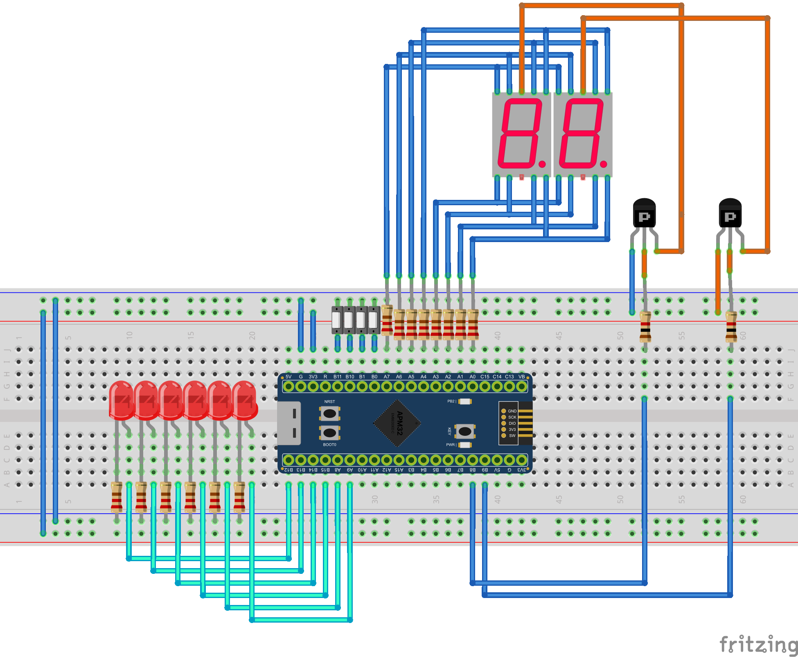

# Full Setup Reference

This is the complete physical assembly that Tutorials 1-3 build up piece by piece -- 6 LEDs, 2 multiplexed 7-segment digits, and 4 debounced buttons, all driven from registers alone. Use this page as the "what does it look like wired up" reference while you work through the tutorials; it isn't a tutorial itself.

---

## Pin Map

| Function | Pin(s) | Mode |
|---|---|---|
| 7-Segment data (A-G, DP) | `PA0`-`PA7` | Output Push-Pull |
| 7-Segment digit selectors | `PB8`, `PB9` | Output Push-Pull |
| LEDs (6) | `PB12`, `PB13`, `PB14`, `PB15`, `PA8`, `PA9` | Output Push-Pull |
| Buttons (4) | `PA10`, `PA11`, `PA12`, `PA15` | Input Pull-Up |

> [!WARNING]
> `PA15` is a JTAG pin by default. Before you can use it as a plain GPIO input, you must disable the JTAG protocol (while keeping SWD) by writing the `SWJCFG` field of `AFIO->REMAP1` (bits 26:24) to `0x2` -- and enable the AFIO clock first (`RCM->APB2CLKEN`, bit 0). See the *Freeing Debug Pins* section of the Pinout tab.

**Button roles used in the full exercise:**

| Button | Pin | Role |
|---|---|---|
| 1 | `PA10` | Move cursor Left |
| 2 | `PA11` | Move cursor Right |
| 3 | `PA12` | Toggle the LED at the cursor |
| 4 | `PA15` | Clear all LEDs |

---

## How It Fits Together

- **Tutorial 1** covers the LED + button basics (output push-pull, input pull-up, debounce) on a subset of these pins.
- **Tutorial 2** covers the 7-segment multiplexing technique (`PA0`-`PA7` + `PB8`/`PB9`) in detail -- including how to verify *your own* display's segment wiring before trusting any `nums[]` table, and how to tell common anode from common cathode if your module differs from the one pictured here.
- Putting all 20 pins together -- LEDs showing a live binary number, the display showing its decimal value, and the 4 buttons controlling a cursor -- is the **"Binary Manipulator (Taller 2)"** example (`APM32: Load Example Project`), which is also the reference implementation for this exact assignment.
